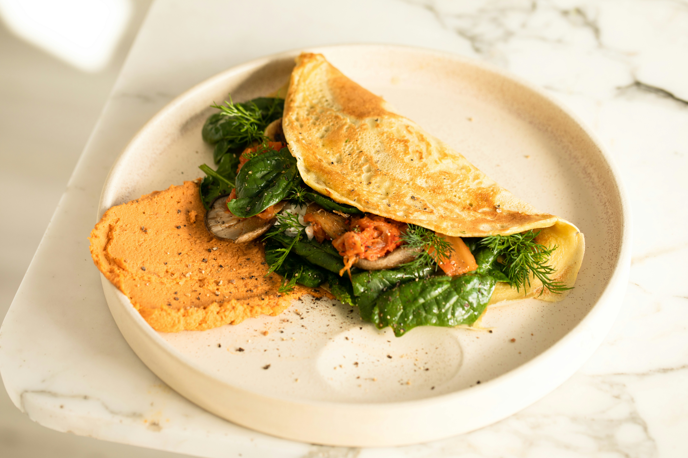

# Recipe Page

A simple omelette recipe page built with HTML and CSS for the Frontend Mentor recipe page challenge. It uses an earthy color palette, serif typography, and rounded recipe sections.

My first HTML and CSS project, created to practice building and styling a web page.



## Features

- Preparation and cooking times.
- Ingredients and step-by-step cooking instructions.
- Nutrition information per serving.
- Custom colors and styling for the recipe sections.

## Built with

- HTML5 for the page structure.
- CSS3 for layout, spacing, colors, and typography.
- System serif fonts, including Cambria and Georgia.

No JavaScript, dependencies, or build step is required.

## Run locally

Clone the repository:

```bash
git clone https://github.com/dogabudakci/recipe-page.git
cd recipe-page
```

Open `index.html` in your browser, or start a local server with Python 3:

```bash
python3 -m http.server 8000
```

Visit [localhost:8000](http://localhost:8000). Press `Ctrl+C` to stop the server.

## Project structure

```text
recipe-page/
├── assets/
│   ├── fonts/      # Bundled fonts and their licenses
│   └── images/     # Recipe photos
├── index.html      # Recipe content
├── style.css       # Page styles
└── README.md
```

## Credits

- Challenge: [Frontend Mentor](https://www.frontendmentor.io/).
- Implementation: [@dogabudakci](https://github.com/dogabudakci).
- Bundled fonts retain their licenses in the corresponding `assets/fonts/` directories.
