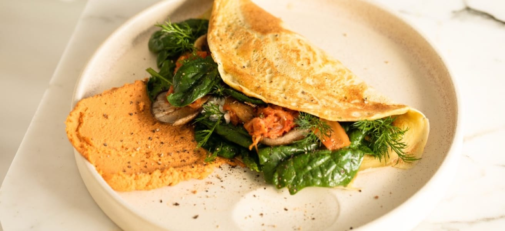

# Recipe Page

A simple omelette recipe page built with HTML and CSS as part of the Frontend Mentor recipe page challenge. The page uses a custom earthy color palette, rounded cards, and serif typography.



## Features

- Preparation and cooking times.
- Ingredients list and step-by-step cooking instructions.
- Nutrition table with values per serving.
- Custom styling for the recipe, preparation, and ingredients sections.

## Built with

- HTML5 for the page content and structure.
- CSS3 for colors, spacing, typography, and layout.
- System serif fonts, including Cambria and Georgia.

No JavaScript, package installation, or build step is required.

## View locally

Clone the repository:

```bash
git clone https://github.com/dogabudakci/recipe-page.git
cd recipe-page
```

Open `index.html` in your browser. You can also serve the folder with Python 3:

```bash
python3 -m http.server 8000
```

Then visit [localhost:8000](http://localhost:8000). Stop the server with `Ctrl+C`.

## Project structure

```text
recipe-page/
├── assets/
│   ├── fonts/          # Bundled challenge fonts and their licenses
│   └── images/         # Recipe photos
├── design/             # Challenge reference designs
├── index.html          # Recipe content
├── preview.jpg         # Provided challenge preview
├── style-guide.md      # Provided challenge style guide
├── style.css           # Custom page styles
└── README.md
```

The reference designs and `preview.jpg` are supplied challenge materials; the current page has its own styling.

## Credits

- Challenge and reference materials: [Frontend Mentor](https://www.frontendmentor.io/).
- Implementation: [@dogabudakci](https://github.com/dogabudakci).
- Bundled fonts retain their licenses in the corresponding `assets/fonts/` directories.
